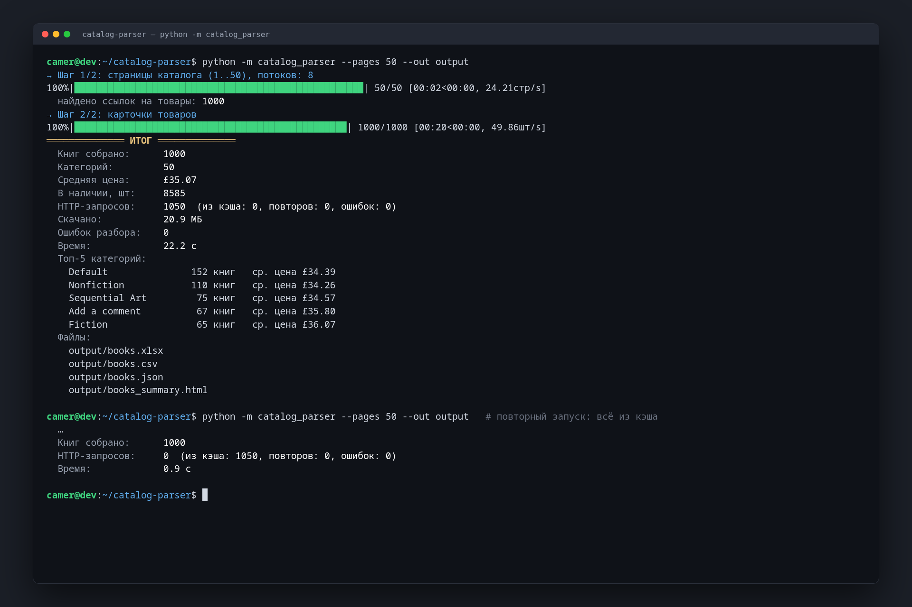
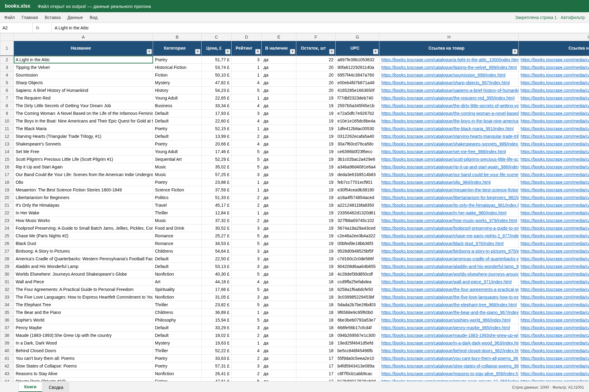
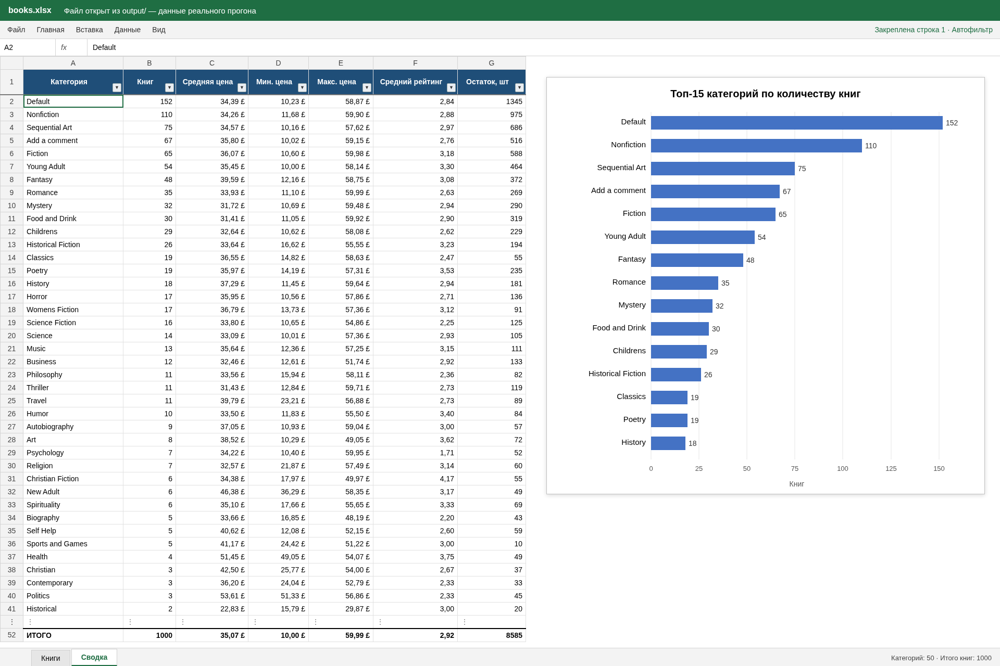

# catalog-parser — асинхронный парсер каталога в Excel

Демо-проект: парсер интернет-каталога с выгрузкой в оформленный Excel, CSV и JSON.
Источник — [books.toscrape.com](https://books.toscrape.com), учебная песочница,
созданная специально для тренировки парсинга (1000 книг, 50 страниц).

## Скриншоты






Полный обход: **1000 карточек за ~22 секунды**, 1050 HTTP-запросов, 0 ошибок.

## Что собирается

| Поле | Пример |
|---|---|
| Название | A Light in the Attic |
| Категория | Poetry |
| Цена (числом, формат £) | 51.77 |
| Рейтинг (1–5) | 3 |
| Наличие / остаток, шт | да / 22 |
| UPC | a897fe39b1053632 |
| Ссылка на товар | https://books.toscrape.com/catalogue/a-light-in-the-attic_1000/index.html |
| Ссылка на фото | https://books.toscrape.com/media/cache/fe/72/…jpg |

## Возможности

- **Асинхронность**: `httpx.AsyncClient` + `asyncio.Semaphore`, по умолчанию 8 одновременных
  запросов (больше 8 CLI не разрешит, чтобы не нагружать сайт).
- **Повторы с экспоненциальной задержкой**: сетевые ошибки, таймауты, 429 и 5xx повторяются
  (0.5 → 1 → 2 → 4 с + случайный джиттер); 404 и прочие 4xx не повторяются.
- **Кэш и продолжение**: каждая скачанная страница атомарно сохраняется на диск. Если обход
  прервать (Ctrl+C, обрыв сети), повторный запуск возьмёт готовое из кэша и докачает остальное.
  Проверено: прерывание на 209 страницах, затем повторный запуск докачал оставшиеся 841.
- **Прогресс-бар** (tqdm) и итоговая сводка в терминале.
- **Excel** (openpyxl):
  - лист «Книги»: стилизованная шапка, закреплённая первая строка, автофильтр, ширина колонок
    по содержимому, цена числом в формате `£`, кликабельные ссылки;
  - лист «Сводка»: по каждой категории число книг, средняя, минимальная и максимальная цена,
    средний рейтинг, остаток; строка ИТОГО на формулах Excel; столбчатая диаграмма топ-15 категорий.
- **CSV** (разделитель `;`, UTF-8 с BOM, поэтому Excel открывает кириллицу без «кракозябр»), **JSON**.
- **HTML-сводка**: статичная страница с KPI и таблицей категорий, открывается в браузере без сервера.

## Стек

Python 3.11+, httpx, selectolax (движок lexbor), openpyxl, tqdm, pytest.

## Запуск

```bash
python -m venv .venv && source .venv/bin/activate
pip install -r requirements.txt

# весь каталог (50 страниц) в ./output
python -m catalog_parser

# первые 5 страниц (100 книг) в другую папку, только Excel и CSV
python -m catalog_parser --pages 5 --out result --formats xlsx,csv
```

Результат:

```
output/books.xlsx          — Excel: «Книги» + «Сводка» с диаграммой
output/books.csv
output/books.json
output/books_summary.html  — HTML-сводка
```

### Параметры CLI

| Флаг | По умолчанию | Описание |
|---|---|---|
| `--pages N` | 50 | сколько страниц каталога обойти (1..50) |
| `--out DIR` | `output` | папка для результатов |
| `--name NAME` | `books` | базовое имя файлов |
| `--formats` | `xlsx,csv,json,html` | какие файлы создать |
| `--concurrency N` | 8 | одновременных запросов (1..8) |
| `--retries N` | 4 | число повторов при ошибке |
| `--delay SEC` | 0 | пауза после каждого запроса |
| `--timeout SEC` | 20 | таймаут запроса |
| `--cache-dir DIR` | `.cache/html` | папка кэша |
| `--no-cache` | — | качать всё заново, без кэша |
| `-v` | — | подробный лог (видно повторы) |

Код выхода: `0` — все карточки собраны; `1` — часть страниц не скачалась или не разобралась
(их адреса выводятся в конце); `2` — неверные аргументы.

## Тесты

```bash
pip install -r requirements-dev.txt
python -m pytest -q
```

24 теста работают офлайн: разбор HTML на сохранённых страницах сайта, повторы при 503,
ошибках соединения и 404 через `httpx.MockTransport`, кэш, обход на имитации сайта,
форматирование xlsx (заморозка, фильтр, числовой формат, лист «Сводка», диаграмма), CSV и
экранирование в HTML-отчёте, защиту от формул-инъекций в xlsx/csv.

## Структура

```
catalog_parser/
  cli.py       — аргументы, запуск, итоговая сводка
  crawler.py   — обход: страницы каталога → карточки товаров
  fetcher.py   — HTTP: лимит потоков, повторы, дисковый кэш
  parsing.py   — чистые функции разбора HTML
  export.py    — Excel / CSV / JSON + агрегаты по категориям
  report.py    — HTML-сводка
  models.py    — модель Book и порядок колонок
tests/         — pytest и HTML-фикстуры
```

## Как адаптировать под другой сайт

Поменять селекторы в `parsing.py` и схему URL в `crawler.py`. Лимит потоков, повторы, кэш
и экспорт от сайта не зависят и остаются как есть.
